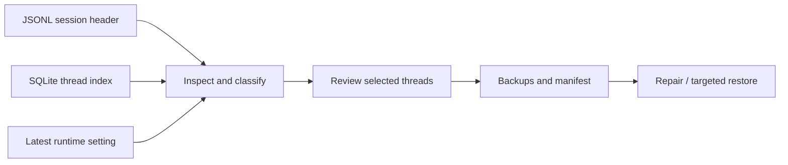

# Codex Repair

**A Windows tool for diagnosing and repairing provider inconsistencies in Codex conversation history, with backups and targeted restore.**

After a provider switch, some existing threads may still reference the previous provider. Codex Repair compares the session file, SQLite index, and latest runtime setting, shows mismatches, and repairs selected threads.

[简体中文](README.md) · [Download v0.6.2 prerelease](https://github.com/KevinJiang05/codex-repair/releases/tag/v0.6.2) · [Usage guide](docs/usage.en.md) · [Validation record](docs/publish-preview.md)

[](https://github.com/KevinJiang05/codex-repair/actions/workflows/windows.yml)

Windows x64 · C# / WinForms · PowerShell · SQLite · MIT

**Before use:** Check the target provider and keep target threads closed throughout repair and restore. The tool saves backups before writing; keep them private. This unofficial prerelease cannot guarantee that matching provider fields will make a thread resume across providers.


*The actual UI is rendered with synthetic IDs, titles, and paths. The GUI is currently in Chinese.*

## The problem

After switching Codex model providers, I found that new threads could work while some resumed threads still used the previous provider. This personal project turns that investigation into a desktop utility: inspect three persisted records, distinguish ordinary mismatches from runtime conflicts, and back up, repair, or restore selected threads.

The provider recorded in a thread index, its JSONL header, and the latest persisted runtime setting can disagree. Updating the index or header alone can miss the setting that affects resume behavior. [CC Switch issue #5922](https://github.com/farion1231/cc-switch/issues/5922) documents a related report.

The tool separates diagnosis from permission to write:

- **Inspect and classify** ordinary and archived threads, runtime conflicts, and invalid files within a date range.
- **Repair selected threads**, leaving runtime conflicts untouched unless advanced mode is enabled and confirmed twice.
- **Restore specific changes**, reverting provider fields while retaining ordinary conversation records appended after repair.

## Download and run

For general use, choose the **Windows x64 portable package**, which needs no separately installed runtime. Choose the script package to inspect or use the PowerShell scripts. Download the full ZIP from the [v0.6.2 prerelease](https://github.com/KevinJiang05/codex-repair/releases/tag/v0.6.2), extract it into a writable directory, and launch **Codex Repair.cmd**.

| Package | Requirements |
| --- | --- |
| [Windows x64 portable (recommended)](https://github.com/KevinJiang05/codex-repair/releases/download/v0.6.2/CodexRepair-v0.6.2-win-x64.zip) | Bundled .NET; no separate PowerShell, Python, or .NET installation |
| [Script package](https://github.com/KevinJiang05/codex-repair/releases/download/v0.6.2/CodexRepair-v0.6.2-script.zip) | Windows PowerShell 5.1 or PowerShell 6/7, and Python 3 |

Inspect the target provider and verify one closed thread before proceeding in batches. See the [usage guide](docs/usage.en.md) for controls, classifications, and restore instructions.

## Design decisions



| Concern | Implementation |
| --- | --- |
| Identify effective state | Compare all three records and use the latest runtime event rather than treating every historical value as current |
| Make failures inspectable | Save recovery information before mutation; use SQLite transactions and expected-value checks; atomically replace JSONL while retaining mtime |
| Handle changing files | Refuse open writers and stale snapshots; preserve content and report failure when another writer intervenes |
| Keep the UI responsive | Background tasks in C#; a separate batch worker process with progress reporting in PowerShell |
| Support review and distribution | Retain the PowerShell implementation alongside a self-contained C# package with no separately installed runtime requirements |

Both implementations have synthetic-data regressions. The application remains a local file utility without a backend or separate database service.

## Development and verification

The PowerShell version uses Python's standard-library sqlite3 module. The C# application uses .NET 8 / WinForms and Microsoft.Data.Sqlite. First builds restore NuGet dependencies automatically.

```powershell
# Windows + PowerShell 7 + Python 3 + .NET 8 SDK
pwsh -NoProfile -File .\tests\smoke.ps1
dotnet build .\src\CodexRepair.Portable\CodexRepair.Portable.csproj -c Release
dotnet .\src\CodexRepair.Portable\bin\Release\net8.0-windows\CodexRepair.dll --self-test
```

Regressions cover standard and advanced repair, backups, targeted restore, retained appended content, mtime, open writers, stale snapshots, manifest failure, database rollback, and unsupported schemas. Windows CI also builds both release packages and checks their contents and checksums.

See the [validation record](docs/publish-preview.md) for local evidence and archive hashes, and the [development guide](docs/usage.en.md#build-and-verify) for packaging commands.

## Scope

This is an **unofficial personal project**, not affiliated with OpenAI, distributed as a prerelease.

- Automated tests use synthetic state_5.sqlite fixtures and specific JSONL event shapes. No full Codex client version has been certified end to end; Windows 10 and PowerShell 6 were not revalidated in this release.
- JSONL and SQLite are separate stores with no single transaction spanning both. Keep target threads closed throughout repair and restore. Matching provider fields cannot guarantee migration of upstream-bound state.
- The target comes from the top-level model_provider setting; profile, project, and command-line overrides are not resolved. Backups may contain full conversations and paths; keep them private. The application does not upload conversations. Binaries are not code-signed.

Further work prioritizes additional client-state formats and compatibility regressions. Issues should contain redacted errors or minimal synthetic reproductions.

## Source map

| Path | Contents |
| --- | --- |
| [src/CodexRepair.Portable](src/CodexRepair.Portable) | WinForms UI, repair engine, and C# self-tests |
| [scripts](scripts) | PowerShell UI, repair, restore, and builders |
| [tests](tests) | Synthetic regressions and archive verification |

A personal project by [Kevin Jiang](https://github.com/KevinJiang05) · [MIT](LICENSE) · [Third-party notices](THIRD-PARTY-NOTICES.txt)
