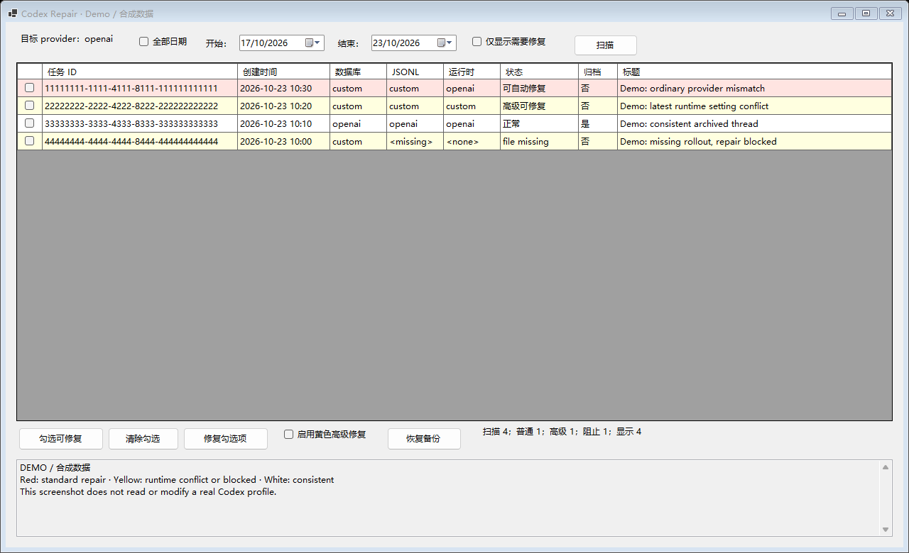
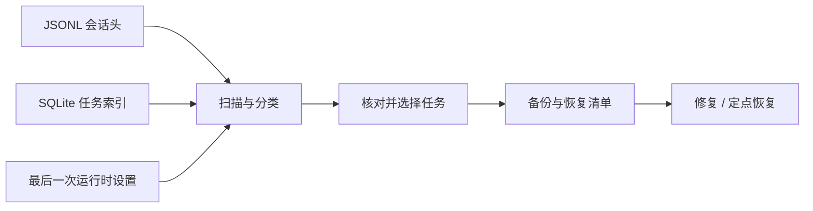

# Codex Repair

**从一次真实的开发工具故障出发，做一个可复用的 Windows 会话诊断与修复工具。**

[English](README.en.md) · [下载 v0.6.2](https://github.com/KevinJiang05/codex-repair/releases/tag/v0.6.2) · [使用指南](docs/usage.md) · [验证记录](docs/publish-preview.md)

[](https://github.com/KevinJiang05/codex-repair/actions/workflows/windows.yml)

Windows x64 · C# / WinForms · PowerShell · SQLite · MIT

我在切换 Codex 的模型提供方（provider）时，遇到了新会话正常、部分旧会话仍使用旧 provider 的问题。这个个人项目把排查过程整理成了图形化工具：检查三处持久化记录，区分普通不一致与运行时冲突，再对选中的任务执行备份、修复和定点恢复。



*实际界面使用合成数据生成；任务 ID、标题和路径均为演示内容。GUI 目前为中文。*

## 项目解决的问题

会话列表里的 provider、JSONL 头部的 provider，以及恢复会话时使用的运行时设置，可能并不一致。仅修改索引或 JSONL 头部，可能遗漏真正影响恢复行为的最后一条设置。相关场景也有 [CC Switch 的公开问题记录](https://github.com/farion1231/cc-switch/issues/5922)。

Codex Repair 同时检查这些状态，把“发现不一致”和“允许写入修复”分开处理：

- **扫描与分类**：按日期查看普通任务、归档任务、运行时冲突和文件异常。
- **选择性修复**：普通模式保留运行时冲突；高级模式需显式启用并二次确认。
- **可核对的恢复**：修复前保存备份和清单，恢复时只撤销相关 provider 字段，保留后来追加的普通对话。

## 实现思路与工程取舍



| 关注点 | 项目中的实现 |
| --- | --- |
| 找到真正生效的状态 | 对照 JSONL、SQLite 和最后一条运行时事件，避免把更早的历史值误判为当前冲突 |
| 让失败有据可查 | 先保存恢复清单；SQLite 使用事务和原值条件；JSONL 通过临时文件原子替换并保留修改时间 |
| 应对正在变化的文件 | 拒绝已打开的写句柄，重新核对内容；并发介入时保留内容并报告失败 |
| 保持桌面交互响应 | C# 使用后台任务执行扫描和修复；PowerShell 批量修复使用独立进程并报告进度 |
| 兼顾可审查与易分发 | 保留 PowerShell 实现，同时提供不要求用户安装运行依赖的 C# 自包含便携包 |

两种实现各有合成数据回归用例。项目保持本地文件工具的结构，不需要服务端或额外数据库服务。

## 运行与下载

从 [v0.6.2 预发布](https://github.com/KevinJiang05/codex-repair/releases/tag/v0.6.2) 下载完整 ZIP，解压到可写目录，双击 **Codex Repair.cmd**。

| 版本 | 适用方式 |
| --- | --- |
| [Windows x64 便携包](https://github.com/KevinJiang05/codex-repair/releases/download/v0.6.2/CodexRepair-v0.6.2-win-x64.zip) | 内置 .NET 运行时，无需另装 PowerShell、Python 或 .NET |
| [纯脚本包](https://github.com/KevinJiang05/codex-repair/releases/download/v0.6.2/CodexRepair-v0.6.2-script.zip) | Windows PowerShell 5.1 或 PowerShell 6/7，以及 Python 3 |

先核对目标 provider，只选择一个已关闭的任务验证，再逐批处理。操作步骤、颜色含义和恢复方法见 [使用指南](docs/usage.md)。

## 开发与验证

源码中的 PowerShell 版本使用 Python 标准库 sqlite3；C# 版本基于 .NET 8 / WinForms 和 Microsoft.Data.Sqlite。首次构建自动恢复 NuGet 依赖。

```powershell
# Windows + PowerShell 7 + Python 3 + .NET 8 SDK
pwsh -NoProfile -File .\tests\smoke.ps1
dotnet build .\src\CodexRepair.Portable\CodexRepair.Portable.csproj -c Release
dotnet .\src\CodexRepair.Portable\bin\Release\net8.0-windows\CodexRepair.dll --self-test
```

回归覆盖普通与高级修复、批次备份、定点恢复、追加内容保留、时间戳、写句柄占用、过期内容快照、清单写入失败、数据库失败回退与未知结构拒绝。Windows CI 还会构建两种分发包并验证包内文件及校验和。

本地验证环境、构建记录和分发包 SHA-256 见 [验证记录](docs/publish-preview.md)；完整打包命令见 [开发指南](docs/usage.md#从源码运行与构建)。

## 适用范围

这是我个人维护的**非官方工具**，与 OpenAI 无隶属关系，目前以预发布形式提供。

- 自动化验证使用合成 state_5.sqlite 和指定 JSONL 事件格式，尚未对完整 Codex 客户端版本进行端到端认证；Windows 10 和 PowerShell 6 未在本轮实测。
- JSONL 与 SQLite 没有单一跨文件事务。修复和恢复期间必须保持目标任务关闭；provider 一致也不能保证上游绑定状态能够迁移。
- 配置只识别顶层 model_provider，不解析 profile、项目配置或命令行覆盖。备份可能包含完整对话及路径，请保持私有；程序不上传会话内容。当前二进制未代码签名。

后续优先验证更多客户端状态格式，并随兼容性变化补充回归。提交问题时请提供脱敏错误或最小合成复现。

## 源码入口

| 路径 | 内容 |
| --- | --- |
| [src/CodexRepair.Portable](src/CodexRepair.Portable) | WinForms 界面、修复引擎与 C# 自检 |
| [scripts](scripts) | PowerShell 界面、修复、恢复与打包 |
| [tests](tests) | 模拟数据回归与分发包验证 |

个人项目 · [Kevin Jiang](https://github.com/KevinJiang05) · [MIT License](LICENSE) · [第三方组件许可](THIRD-PARTY-NOTICES.txt)
